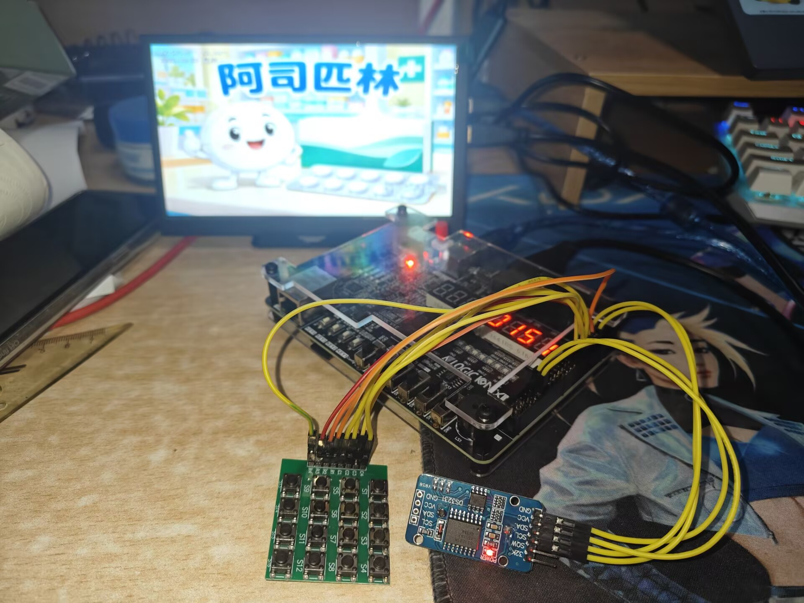

# FPGA智能药箱多媒体播放系统

基于安路 EG4S20 FPGA 的桌面演示系统，将用药科普播放、用药计划设置和定时提醒集成在同一开发板上。通过 HDMI 输出图像与声音，使用矩阵键盘编辑计划，DS3231 提供时间，AT24C32 保存计划。



## 主要功能

- 从 FAT32 TF 卡读取 5 张图片、15 段讲解和 3 首音乐，输出 640×480 图像与音频。
- 图片等比例缩放，支持手动或自动轮播、5 种转场，以及亮度、对比度和音量调节。
- 中文字幕按实际消费的 PCM 采样推进；显示同一路音频的波形与 Haar 近似八频带幅度。
- 本机设置 4 种固定药物、每药 4 个时点，共 16 条计划，保存后断电保留。
- 到点显示对应药图和用量，联动讲解、字幕、LED 和蜂鸣器；结束后返回原图片和播放模式，讲解或歌曲从头播放。
- 显示日期、时间及 DS3231 芯片温度，提供高低温提示。

现有版本已完成 Flash 固化和上板演示，可上电独立运行。该装置为科普与提醒原型，未包含自动出药机构或服药确认功能。

## 目录

| 路径 | 内容 |
|---|---|
| `FPGA/TD/SmartMedicineBox.al` | TD 工程入口 |
| `FPGA/user_source/` | RTL、IP、字模和引脚及时序约束 |
| `FPGA/verification/` | 温度提示的仿真脚本、测试平台和参考数据 |
| `FPGA/build.py` | TD 命令行构建脚本 |
| `SmartMedicineBox.bit` | 已上板版本的配置文件 |
| `校时/` | Windows 人工串口校时工具 |
| `tools/` | 仓库核验工具、字模辅助工具和仿真工具说明 |
| `docs/` | 实物图、输入校验清单及历史测试证据 |
| `使用说明.md` | 接线、按键和日常操作说明 |

## 开始使用

硬件为 HX4S20C 开发板（EG4S20BG256）、支持 HDMI 音频的显示设备、TF 卡、DS3231/AT24C32 小板和 4×4 无源矩阵键盘。接线和操作见[使用说明](使用说明.md)。

从仓库的 **Releases** 下载 `tf-media.zip`，将其中 25 个文件直接放入 FAT32 TF 卡根目录。已烧录现行配置的开发板可以直接上电使用；需要下载配置时使用本目录的 `SmartMedicineBox.bit`。

源码、工程和 bit 放在代码仓库中；TF 素材、历史验证压缩包及 Windows 仿真运行库作为 Release 附件发布。编译输出和本地工具运行文件由 `.gitignore` 排除。

## 打开或构建工程

使用 Windows 和安路 TD 6.2.1，打开 `FPGA/TD/SmartMedicineBox.al`。如果 TD 提示是否恢复非默认 private parameters，选择 **Cancel**，保留已经保存的 `pack_mode` 和 `seed`。

也可在 TD 工具已加入 `PATH` 的环境中运行：

```powershell
cd FPGA
python build.py
```

脚本使用 TD 安装目录中的原始 `DefaultFlow.tcl`；未通过 `PATH` 找到 TD 时，默认安装位置为 `D:/fpga/bin`。运行脚本构建前应保存并关闭 TD 和 BitWriter。新增功能后，需要重新检查综合、布局布线和时序结果。

## 核验与仿真

仓库文件核验只需要 Python 3.9 或以上版本：

```powershell
python tools/check_repository.py
```

Windows 也可以直接运行根目录的 `检查文件.cmd`。

`.gitattributes` 保留工程输入的原始字节，避免 Git 自动转换换行后改变文件校验值。将 `TF卡素材.zip` 放到仓库根目录后，可一并核验素材：

```powershell
python tools/check_repository.py --media
```

移动仓库后，如果 TD 需要更新工程根路径，可以运行 `python tools/check_repository.py --prepare-project`；该选项只修正工程根路径元数据。

重新运行温度提示仿真还需要 `numpy`、`Pillow` 和 Windows Icarus 运行库。从 Releases 下载 `rtl-sim-tools.zip`，解压到仓库根目录，得到 `tools/rtl_sim/icarus/`。完整像素测试还需要将下载的 tf-media.zip 需要先重命名为 TF卡素材.zip，再放到仓库根目录。

```powershell
python -m pip install numpy Pillow
cd FPGA
python verification/run_hint_tests.py
python verification/run_integration_test.py
```

仿真入口适用于 Windows；像素预览使用 Windows 自带的微软雅黑字体。测试输出写入 `FPGA/verification/`。`docs/` 中保存的是已有验证证据，重新运行的结果以本地输出为准。

